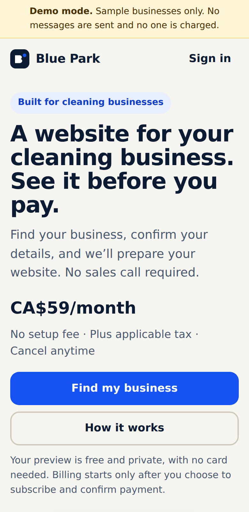
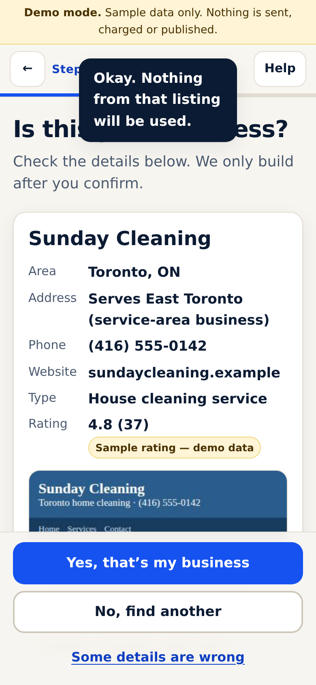
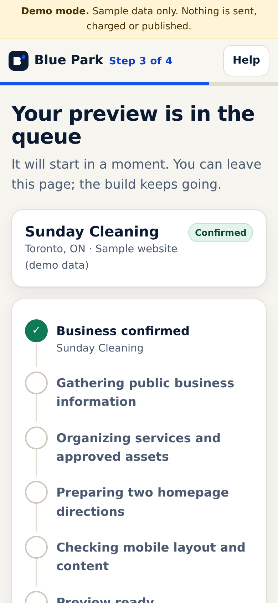
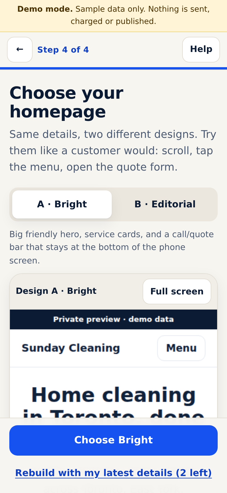
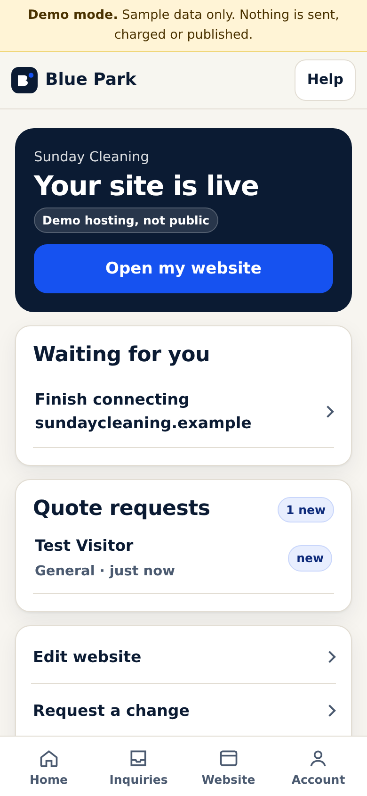

# Blue Park

A website platform for cleaning businesses, built for phones first. A cleaner finds their business, confirms it, reviews prefilled details, watches the preview being built, picks one of two designs, edits the site, subscribes and launches. There is no sales call. Support and operations review happen asynchronously.

> **A website for your cleaning business. See it before you pay.**
> CA$59/month · no setup fee · free private preview

| Landing | Confirm | Progress | Designs | Dashboard |
|---|---|---|---|---|
|  |  |  |  |  |

## Run it

Requires **Node 22.18+**. The runtime has no npm dependencies: it uses Node's built-in SQLite and TypeScript type stripping.

```bash
npm install          # dev tools only: typescript, @types/node, playwright-core
npm run dev          # demo mode on http://localhost:3000
```

- Customer flow: open `/`, tap **Find my business**, and try `Sunday Cleaning`.
- Operations: open `/admin` and tap **Enter demo admin**. This button exists only in demo mode.

Demo fixtures (all fictional, using 555-01xx numbers and `.example` domains):

| Type this | What it shows |
|---|---|
| `Sunday Cleaning` or `sundaycleaning.example` | Exact match with a sample screenshot, a phone number that conflicts between the website and the listing, and one source that fails |
| `Sparkle Clean` | Ambiguous name, so it asks for a location, then shows three similar businesses (try the wrong-match path) |
| `brightnest.example` | Website unreachable: no screenshot, structured summary, partial-source warning |
| `Maple Fresh` | No website, only a Google-style listing |
| “My business isn’t online yet” | Manual start |
| Notify a destination ending in `0199` or containing `fail` | Simulated notification failure |
| Simulated checkout → “Simulate a declined card” | Failed payment, then retry |
| Connect any domain | DNS stays “waiting”: demo never pretends DNS is verified |

## Checks

```bash
npm run typecheck    # tsc over server, shared, browser code and tests
npm test             # 21 tests: full journey + rules (auth, CSRF, idempotency, SSRF, provenance, gates…)
npm run ui:check     # Chromium at 390px drives the whole journey; fails on console errors, 5xx, horizontal overflow
npm run examples     # regenerate landing-page example images from the real templates
```

`ui:check` also records lab LCP/CLS readings, unthrottled and with network/CPU throttling. These are lab numbers, not field data.

## Architecture

```
server/
  app.ts, main.ts       HTTP server, static + type-stripped browser modules, security headers
  routes.ts             JSON API, previews (sandboxed), hosted sites, demo checkout, admin
  auth.ts               anonymous session → verified contact (one-time code), magic links, admin
  db.ts                 SQLite schema (projects, source_snapshots, observations, owner_facts, jobs, …)
  security/ssrf.ts      safe fetching of user-supplied URLs (private-IP block at connect time, redirect/size caps)
  services/
    jobs.ts             durable queue (idempotency keys, retries with backoff, stale-lock recovery, in-place retry)
    pipeline.ts         research → organize → compose (2 directions) → QA → deliver; build_site; launch
    facts.ts            public observations vs owner-confirmed facts, provenance and conflicts
    sitegen.ts          deterministic templates (Bright / Editorial), ≤5 pages, no invented claims
    quality.ts          checks: viewport, single h1, tap-to-call, alt text, private-contact leaks, claim words
    edits.ts            self-service edits, versions/restore, team proposals previewed before approval
    billing.ts          checkout + webhook-driven subscription state (exactly-once event handling)
    domains.ts          customer-owned domains: TXT ownership + CNAME/A records, real DNS checks
    notify.ts           consented, verified notification destinations; delivery records
  adapters/
    types.ts            boundaries: lookup, research, screenshots, notify, payments, domains, publish
    demo/               fixtures, clearly labeled, no network
    live/               website crawl, Google Places, Playwright screenshots, Stripe, Telnyx, Resend, DNS, self-hosting
shared/                 types, offer config, validation (used by server and browser)
web/app/                mobile-first UI (vanilla TS modules, lazy-loaded screens), admin
fixtures/demo.ts        Sunday Cleaning and other fictional businesses
```

**Commercial terms** live in `shared/offer.ts`: price, scope, limits, turnaround and cancellation wording. Review gates and service targets can also be changed at runtime in `/admin/settings`.

**Honesty rules enforced in code:**
- Demo data is labeled everywhere.
- Notifications are recorded as `simulated`, never as `delivered`.
- Payment state only changes through verified webhook events, never through the checkout redirect.
- A site is only marked live after its public URL check passes. Demo hosting is labeled as not public.
- Owner corrections are never overwritten by later research.
- A rejected match deletes its facts.

## Going live

Set `BLUEPARK_MODE=live` and the values in `.env.example`. In live mode, each adapter that isn't configured reports itself unavailable. It never falls back to sample data.

| Capability | Needs | Status without it |
|---|---|---|
| Website lookup and crawl | nothing | works (bounded crawl, SSRF-guarded) |
| Name / Google Maps lookup | `GOOGLE_PLACES_API_KEY` | “not connected”: user is asked for a website link instead |
| Screenshots | Chromium + `playwright-core` | structured summary, “screenshot unavailable” |
| Payments | Stripe keys + recurring price + webhook to `/api/webhooks/payments` | checkout returns “payment isn’t connected yet” |
| Email / SMS | Resend / Telnyx keys | sign-in codes and notifications unavailable on that channel |
| Hosting | deploy behind HTTPS at `PUBLIC_BASE_URL`; customer domains point at `HOSTING_CNAME_TARGET` / `HOSTING_APEX_IP` | — |

## Known gaps before production

- **Live adapters are untested against real services.** The Google Places, Stripe, Telnyx and Resend adapters follow those providers' documented REST APIs but have never run with real keys. The website crawl was not exercised against the public internet either, because this build environment has no outbound DNS. Test each in staging first.
- **TLS for customer domains** needs a reverse proxy with on-demand certificates (for example, Caddy) in front of the app. It isn't included. Until it exists, the SSL status shows “being issued”, not “ready”.
- **SMS delivery receipts** (Telnyx webhooks) aren't wired up, so text messages stay `queued` and never show `delivered`.
- **Billing self-service**: there is no Stripe customer portal yet for updating a card, and `past_due` is only displayed.
- **Single node**: SQLite, a local-disk upload store, and rate limits held in memory. Moving to Postgres and object storage means writing a new adapter, with no change to the services.
- **Admin** uses one shared password, with no per-user accounts or 2FA.
- **Copy is deterministic** (template sentences built from confirmed facts). No AI writing model is connected; one would plug in behind `sitegen`.
- **Site export on cancellation** is manual (the team sends the site text and uploaded photos on request).
- Existing local tools (Preview Engine playbooks, OpenClaw, Higgsfield workflows) live on the founder’s laptop and weren’t reachable from this environment, so they aren’t connected.
